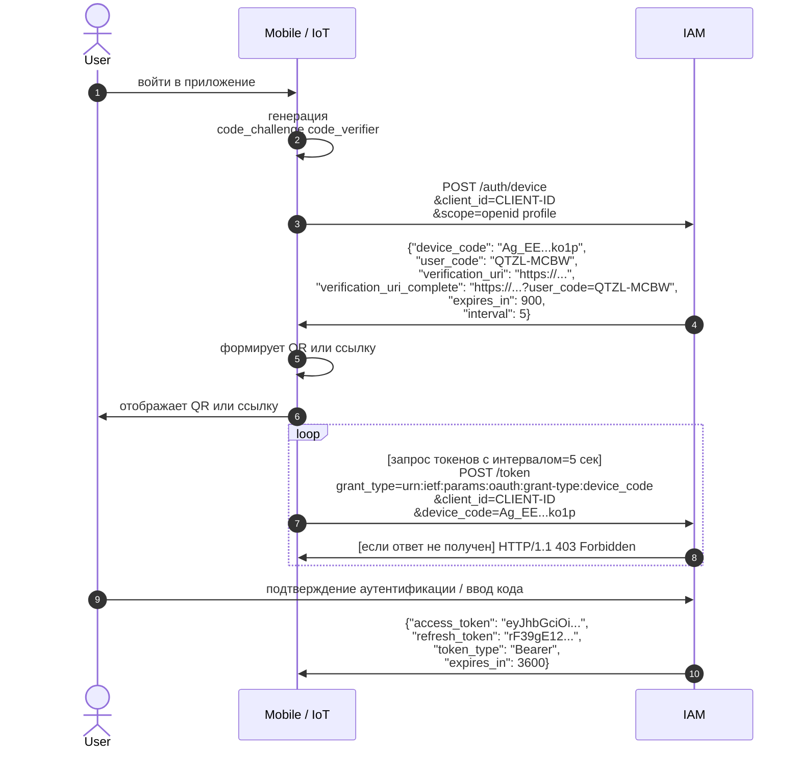

Протокол OAuth 2.0 Device Authorization Grant (RFC 8628) создавался для устройств без браузера, где манипуляции с передачей ссылки ограничены и проектировался для публичных клиентов
Суть атаки на которой уже спотыкались такие продукты Microsoft 365 [1], Entra ID [2] и Azure AD [3]
Device Code  
1. Атакующий делает запрос на эндпоинт IAM auth/device, через десктоп приложение или его компрометацию и получает:
device_code —  по сути идентификатор сессии на стороне клиента (остается у злоумышленника).
user_code — короткий буквенно-цифровой код для пользователя (например, WXYZ-7890).
verification_uri — ссылка на страницу ввода кода в IAM.
2. Атакующий берет user_code (или прямую ссылку с предзаполненным кодом ?code=WXYZ-7890) и передает его пользователю. 
3. Пользователь переходит по ссылке на IAM, если ранее пользователь входил в другую подключенную корп систему - сработает SSO и пользователю ничего вводить не нужно (1 click attack).
4. Поскольку введенный user_code был привязан к device_code, который изначально запросил злоумышленник и сохранился у него, IAM связывает успешную авторизацию жертвы с сессией злоумышленника.
5. Приложение злоумышленника (которое всё это время опрашивало сервер — polling) получает валидные access_token и refresh_token от имени жертвы-пользователя.

[1] https://www.microsoft.com/en-us/security/blog/2026/09/22/unmasking-eviltokens-getting-to-the-root-of-device-code-phishing/#what-is-device-code-phishing
[2] https://www.microsoft.com/en-us/security/blog/2025/02/13/storm-2372-conducts-device-code-phishing-campaign/
[3] https://techcommunity.microsoft.com/blog/coreinfrastructureandsecurityblog/device-code-flow-the-gift-that-keeps-on-giving-%E2%80%94-to-attackers/4540949

Поэтому использование device code там где это не предусмотрено рождает новые проблемы и как следствие новые компенсирующие меры защиты которые мы будем вынуждены рассматривать вместе, такие как
взаимную аутентификацию на x509, выделение взаимодействия в выделенный сетевой сегмент, сокращение времени жизни сессий пользователей и сессионых идентификаторов, ограничение прав у access токенов и т.п. 
