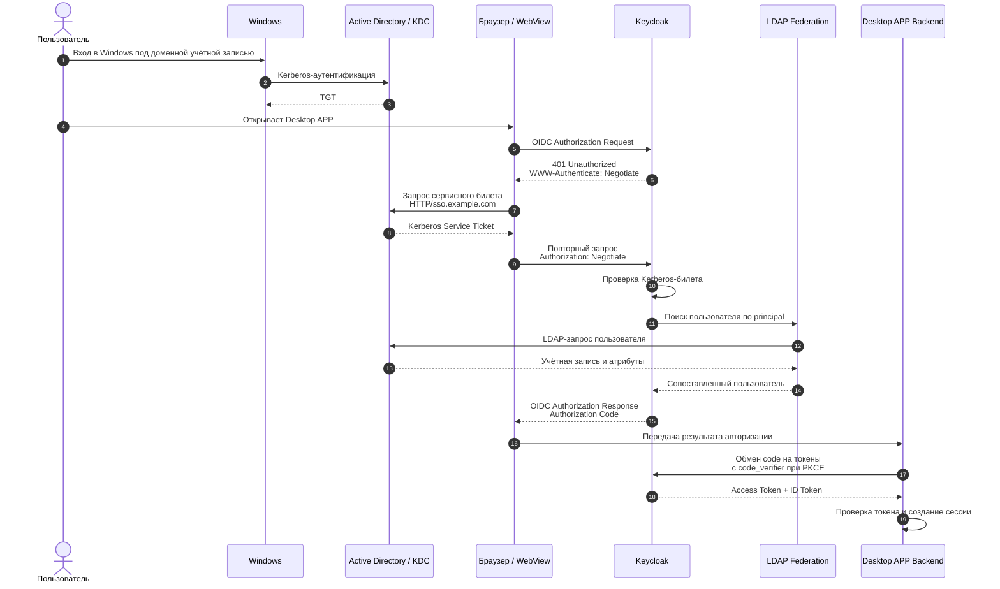

SPNEGO (Simple and Protected GSS-API Negotiation Mechanism): механизм обертки (RFC 2478 / RFC 4559), позволяющий клиенту и серверу договориться о методе аутентификации (обычно выбирается Kerberos, а в качестве запасного варианта — устаревший NTLM)

HTTP Negotiate: заголовок HTTP-протокола (WWW-Authenticate: Negotiate и Authorization: Negotiate), через который передаются токены SPNEGO.

Kerberos: сетевой протокол аутентификации на основе билетов (tickets), использующий Центр распределения ключей (KDC), чаще всего в Microsoft Active Directory.

