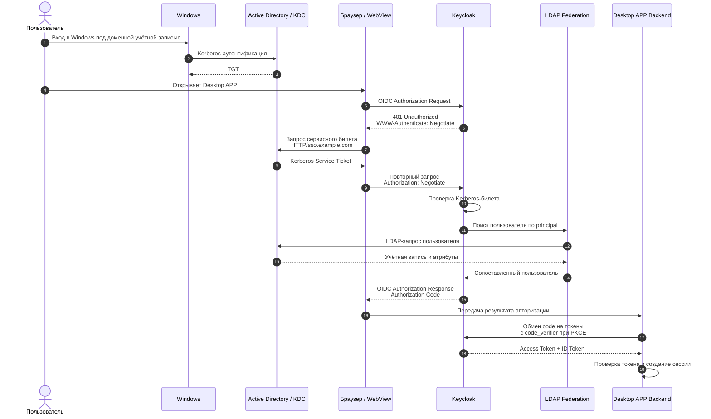

SPNEGO (Simple and Protected GSS-API Negotiation Mechanism): механизм обертки (RFC 2478 / RFC 4559), позволяющий клиенту и серверу договориться о методе аутентификации (обычно выбирается Kerberos, а в качестве запасного варианта — устаревший NTLM)

HTTP Negotiate: заголовок HTTP-протокола (WWW-Authenticate: Negotiate и Authorization: Negotiate), через который передаются токены SPNEGO.

Kerberos: сетевой протокол аутентификации на основе билетов (tickets), использующий Центр распределения ключей (KDC), чаще всего в Microsoft Active Directory.

Типичный сценарий:
1. Пользователь входит в Windows под доменной учётной записью.
2. Active Directory KDC выдаёт ему Kerberos TGT (Ticket-Granting Ticket).
3. Пользователь открывает десктопное приложение, использующее Keycloak для аутентификации.
4. Приложение вызывает системный браузер или webview с запросом на аутентификацию OIDC auth code flow Keycloak `https://iam.com/.../auth?client_id=native&redirect_uri=...&scope=openid...`
5. Keycloak понимает что за клиент и требует Kerberos-аутентификацию через HTTP-заголовок WWW-Authenticate: Negotiate.
6. Браузер запрашивает через механизм ОС `Windows SSPI` запрашивая SPNEGO-токен 
7. Windows обращается к KDC в Active Directory и получает билет Kerberos Ticket-Granting Service (TGS) пользователя для HTTP/iam.com, если нужного билета ещё нет в кэше и далее SSPI сам преобразует билет в SPNEGO-токен и возвращает в браузер
8. Браузер формирует новый запрос в keycloak прикрепляя SPNEGO-токен как `https://iam.com/.../auth?... + Authorization: Negotiate <SPNEGO_TOKEN>`
9. Keycloak проверяет билет и устанавливает личность пользователя через федерацию LDAP
10. Keycloak выдаёт приложению токены OIDC refresh / access
Результат: пользователь уже аутентифицирован в Windows, поэтому при переходе в приложение ему не нужно повторно вводить пароль.

